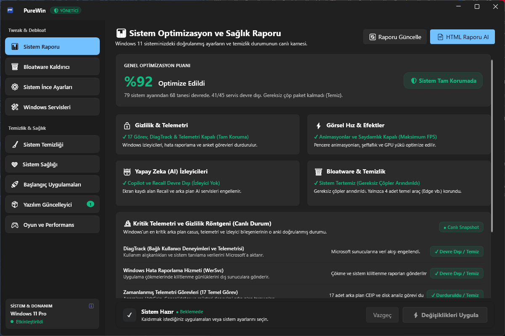
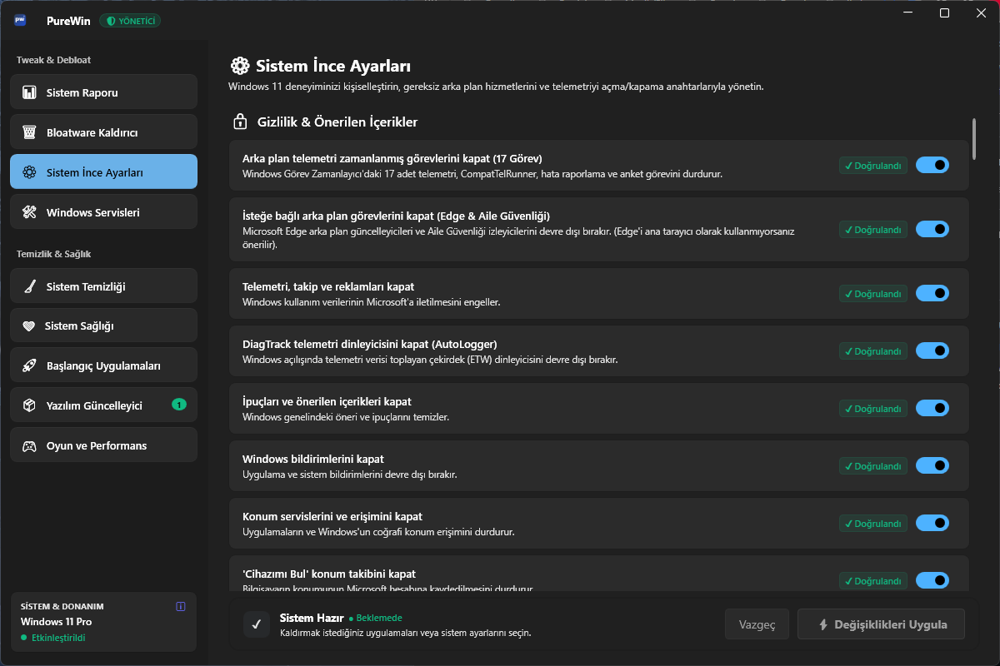
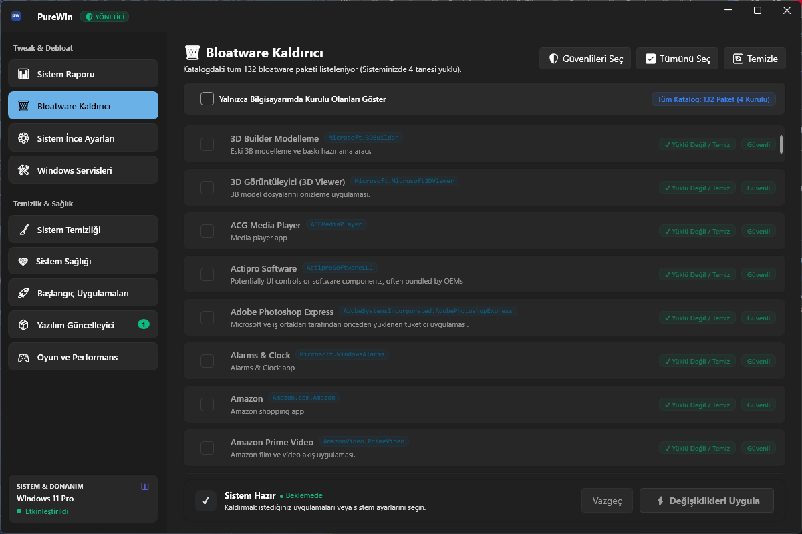
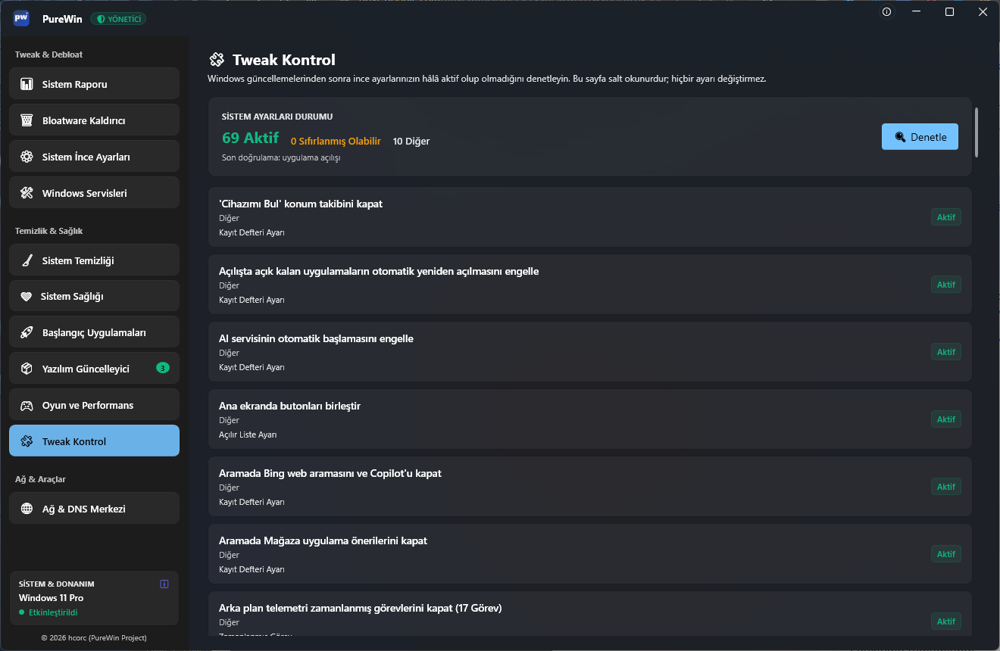
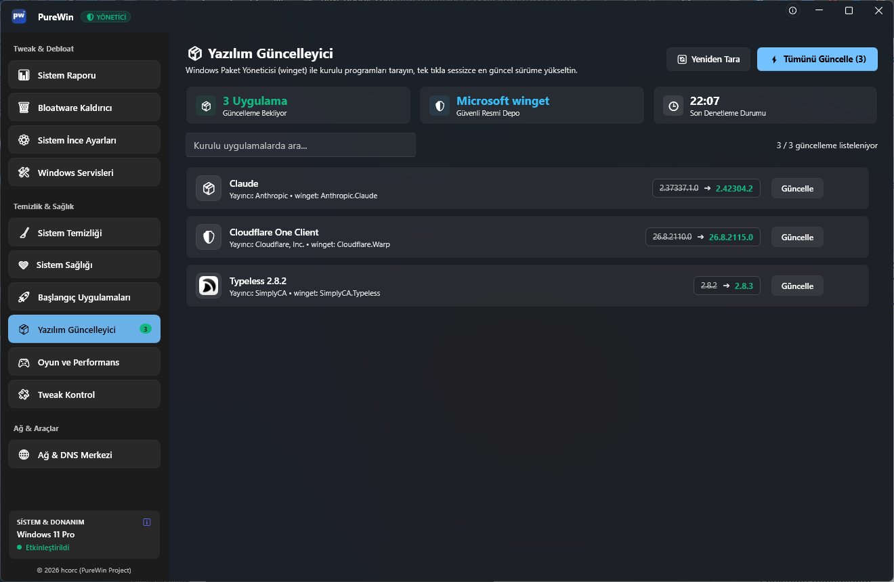

<p align="center">
  
</p>

<h1 align="center">PureWin</h1>

<p align="center">
  <b>Windows 10/11 için tek tıkla optimizasyon, gizlilik ve temizlik aracı.</b><br>
  Kurulum gerektirmez · Türkçe arayüz · Açık kaynak (MIT)
</p>

<p align="center">
  
  
  
  
</p>

---

## 📌 PureWin Nedir?

PureWin, Windows 10/11 bilgisayarınızı hızlandırmak, gereksiz arka plan yükünü azaltmak ve gizliliğinizi güçlendirmek için geliştirilmiş kapsamlı bir optimizasyon aracıdır. Sistem ayarlarını **canlı olarak okur**, yaptığı her değişikliği izler ve dilediğiniz an geri almanızı sağlar.

## 🆕 v1.1.0 Yenilikleri

- **Tweak Kontrol:** Windows güncellemeleri sonrası tweak'lerin hâlâ etkin olup olmadığını salt okunur olarak denetler; değişenleri listeler.
- **Ağ & DNS Merkezi:** Ayrı pencerede IPv4 DNS yönetimi; otomatik (DHCP) algılama, statik DNS, DNS önbelleği temizleme ve geri alma.
- **Yazılım Güncelleyici:** winget ile yüklü uygulamaları tarar; güncellemeleri ilk açılışta otomatik listeler.
- **Başlangıç Uygulamaları:** Kaynak ve etki bilgileriyle başlangıç yönetimi.
- **Hakkında:** Sürüm, sistem ve konum bilgileri; GitHub butonu ve klavye erişimi.
- **Düzeltmeler:** Hakkında odak/Tab/Enter/Esc, DNS penceresiyle sıralama ve güncelleyici ilk açılış düzeltmeleri.

Ayrıntılı sürüm notları: [v1.1.0 release](https://github.com/hcorc/PureWin/releases/tag/v1.1.0)

## ✨ Öne Çıkan Özellikler

| | Özellik | Ne yapar? |
|---|---|---|
| 🔒 | Gizlilik & Telemetri | DiagTrack, hata raporlama servisi ve 17 zamanlanmış telemetri görevini kapatır. |
| 🤖 | Copilot & Recall | Windows'un AI izleyicilerini ve ekran geçmişi kaydını devre dışı bırakır. |
| ⚙️ | Windows Servisleri | 45 servisi "Güvenli / İsteğe Bağlı" olarak sınıflandırır; gereksizleri güvenle kapatır. |
| 🗑️ | Bloatware Kaldırıcı | Önyüklü gereksiz uygulamaları kaldırır (Edge vb. 4 temel araç korunur). |
| 🚀 | Görsel Hız & Efektler | Animasyon, şeffaflık ve efektleri kapatarak akıcılığı artırır. |
| 🎮 | Oyun ve Performans | Oyun modu, GPU planlama (HAGS) ve performans ayarları. |
| 🔎 | Windows Search | Arka plan disk indekslemeyi isteğe bağlı olarak kapatır. |
| 🧹 | Sistem Temizliği | Geçici dosyaları ve paket artıklarını derinlemesine temizler. |
| 📊 | Canlı Sağlık Raporu | Sistem durumunu puanlar ve eksikleri tek bakışta gösterir. |
| 🛡️ | Tweak Kontrol | Güncelleme sonrası tweak durumlarını salt okunur denetler; değişenleri listeler. |
| 🌐 | Ağ & DNS Merkezi | IPv4 DNS'i otomatik (DHCP) veya statik yönetir; önbelleği temizler ve değişiklikleri geri alır. |
| ⬆️ | Yazılım Güncelleyici | winget ile yüklü uygulamaları tarar, güncellemeleri listeler ve tek tıkla uygular. |
| 🚦 | Başlangıç Uygulamaları | Başlangıçta açılan uygulamaları etki dereceleriyle gösterir; tek tıkla açar/kapatır. |
| ℹ️ | Hakkında | Sürüm, sistem ve konum bilgileri; GitHub bağlantısı ve klavye erişimi. |
| ⏪ | Geri Alma | Uygulanan tüm değişiklikler uygulama içinden geri alınabilir. |

## 📷 Ekran Görüntüleri

<p align="center">
  <br>
  <i>Sistem Optimizasyon ve Sağlık Raporu — canlı durum ve puanlama</i>
</p>

<p align="center">
  <br>
  <i>Sistem İnce Ayarları — istediğiniz optimizasyonları seçin</i>
</p>

<p align="center">
  <br>
  <i>Bloatware Kaldırıcı — gereksiz önyüklü uygulamaları temizleyin</i>
</p>

<p align="center">
  <br>
  <i>Tweak Kontrol — güncelleme sonrası tweak durumlarını denetleyin</i>
</p>

<p align="center">
  <br>
  <i>Yazılım Güncelleyici — winget ile güncellemeleri tek tıkla uygulayın</i>
</p>

## 🚀 Hızlı Başlangıç

En kolay yol — **[Releases](../../releases)** sayfasından hazır paketi indirin:

1. Size uygun paketi indirin:
   - **`PureWin_Portable_v1.1.0.zip`** — **Önerilen.** Kurulum gerektirmez; .NET dahil her şeyi kendi içinde taşır.
   - **`PureWin_Lite_v1.1.0.zip`** — Küçük boyutlu sürüm; bilgisayarınızda .NET 8 Desktop Runtime gerektirir.
2. ZIP dosyasını bir klasöre çıkarın.
3. `PureWin.exe` dosyasına çift tıklayın.

> ⚠️ Windows SmartScreen uyarısı görürseniz **"Daha fazla bilgi" → "Yine de çalıştır"** seçin. Uygulama sistem ayarlarını yönettiği için **yönetici izni** ister.

## 🖥️ Sistem Gereksinimleri

- Windows 10 / Windows 11 (x64)
- Yönetici yetkisi (sistem ayarlarını değiştirir)
- Lite sürüm için ayrıca: [.NET 8 Desktop Runtime](https://dotnet.microsoft.com/download/dotnet/8.0)

## 🔧 Kaynaktan Derleme

Gereksinimler: **Windows** + **[.NET 8 SDK](https://dotnet.microsoft.com/download/dotnet/8.0)**

```bash
git clone https://github.com/hcorc/PureWin.git
cd PureWin
dotnet build -c Release
```

Tek dosyalık (self-contained) paket üretmek için:

```bash
dotnet publish -c Release -r win-x64 --self-contained true -p:PublishSingleFile=true -p:DebugType=None -o publish
```

## 🗂️ Proje Yapısı

```
PureWin/
├─ Services/            # Optimizasyon servisleri (telemetri, servisler, oyun, temizlik, DNS...)
├─ Models/              # Veri modelleri
├─ Helpers/             # Yardımcı sınıflar
├─ Assets/              # İkon ve görseller
├─ Config/              # Uygulama veritabanı (bloatware listesi)
├─ Regfiles/            # Registry düzenleme dosyaları (282 adet)
├─ NetworkDnsWindow.xaml(.cs) # Ağ & DNS Merkezi
├─ MainWindow.xaml(.cs) # Ana arayüz
└─ PureWin.csproj
```

## ⚠️ Önemli Notlar

- Uygulama sistem ayarlarını değiştirir; kullanım öncesi **geri yükleme noktası** oluşturmanız önerilir.
- Tüm değişiklikler uygulama içindeki **Geri Al (Undo)** mekanizmasıyla geri alınabilir.
- Program "olduğu gibi" sunulur; kullanım sorumluluğu kullanıcıya aittir (bkz. Lisans).

## 🤝 Katkı

Hata bildirimi ve öneriler için **Issues** bölümünü kullanabilirsiniz. Pull request'ler memnuniyetle karşılanır.

## 📄 Lisans

Bu proje **MIT Lisansı** ile lisanslanmıştır — ayrıntılar için [LICENSE](LICENSE) dosyasına bakın.

Copyright © 2026 **hcorc (PureWin Project)**
